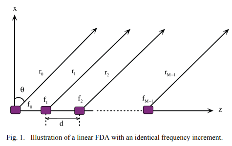
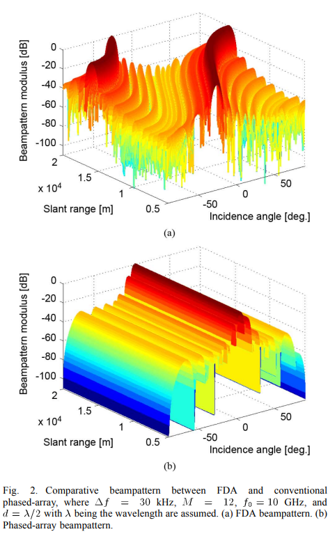
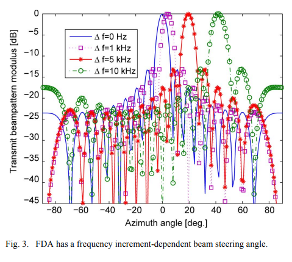
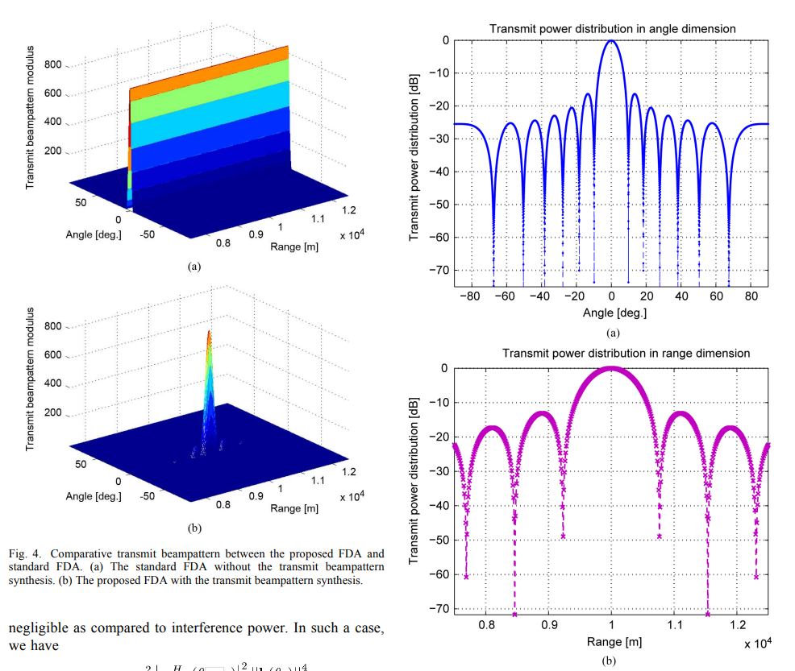
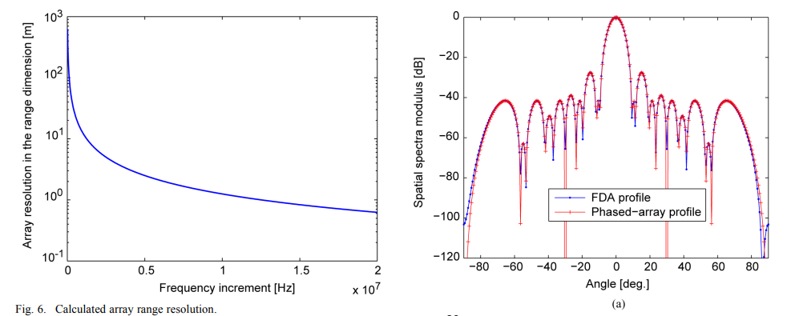
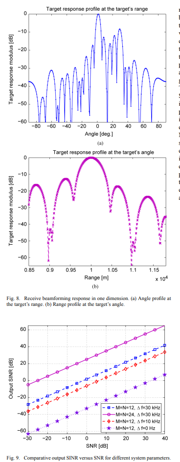

# [FDA] Linear Frequency Diversity Arrays: Distance-Angle Correlated Transmitted Beam Pattern Comprehensive Analysis [with MATLAB Code]

The phased array is widely used in communication and radar systems, but its beam direction is fixed at a certain angle for all distances. This paper proposes a linear frequency-division multiplexing array (FDA) distance-angle-dependent beam directional pattern synthesis scheme based on discrete ellipsoidal sequences, aiming to focus the transmitted energy on the desired two-dimensional spatial area. Unlike traditional phased arrays, FDA employs small frequency increments relative to the carrier frequency between array elements. This distance-angle-dependent beam directional pattern synthesis method enables FDA to emit energy at desired distance or angle sectors, providing potential for suppressing distance-related clutter and interference, which is not possible with traditional phased arrays. The system performance of the proposed FDA is evaluated by outputting Signal-to-Interference-plus-Noise Ratio (SINR), and the effectiveness is verified through comprehensive numerical simulation results.
Introduction: The phased array has been widely applied in many modern communication, radar, and navigation systems. With directional gain, it helps detect / track weak targets in the observation direction of radar, while suppressing strong sidelobe interference from other directions. However, the phased array has limitations; its beam direction is fixed at a certain angle for all distances, making it difficult to mitigate undesired distance-related interference, thereby reducing the ability to resolve distance-related targets. Moreover, to focus the transmitted energy at different distances, multi-antenna or multi-beam antennas are required.
In recent years, a flexible array of beam scanning known as the Frequency Division Multiplexing Array (FDA) has been proposed. The FDA discussed in this paper differs from conventional Multi-Input Multi-Output (MIMO) arrays, where each antenna utilizes orthogonal waveforms. The most significant difference between FDA and traditional phased arrays is that their array elements use small frequency increments. Research indicates that the apparent beam pointing angle of FDA can exceed its actual beam space, providing greater freedom and additional capabilities for system design. Studies have suggested that FDA can perform multiple tasks simultaneously by leveraging spatial, temporal, frequency, and modulation degrees of freedom. Two patents on FDA radar have been approved, discussing the added degrees of freedom. The continuous beam scanning characteristics of FDA, its low-cost design, and research on its distance-dependent and periodic beam directional patterns have also yielded results, especially in the application of high-resolution radar imaging, demonstrating its advantages.

In recent years, FDA has received considerable attention, but most published work has focused on analyzing the distance-dependent beam directional pattern characteristics. One unresolved issue is how to precisely control the beam direction at desired distances due to the coupling between the beam directional pattern and distance and angle. The apparent scanning angle of FDA does not equal the nominal scanning angle, meaning precise beam control relies on distance and angle parameters. Therefore, unlike traditional phased arrays, FDA provides new degrees of freedom for the design and control of antenna beam directional patterns in terms of distance, angle, and time, offering possibilities for beam scanning without phase shifters or mechanical controls and designing distance-angle-related transmit beam directional patterns. Research based on quasi-continuous waveforms (QCW) has proposed penalty functions and optimized them using genetic algorithms to reduce dynamic range, but only considered waveform optimization and signal processing in the distance dimension, while FDA requires two-dimensional processing.
This paper proposes a linear FDA-based approach to combine distance-angle dependent beamforming, aiming to focus the transmitted energy on desired two-dimensional spatial regions. Beamforming design has been widely applied in array processing, offering various performance improvements such as reducing computational burden, enhancing beamforming performance, and improving direction of arrival (DOA) estimation performance. However, most traditional beamspace design techniques have one drawback: they essentially ignore interference outside the desired beamspace sector. Therefore, current beamforming synthesis technologies may be insufficiently robust against such sector-outside interference in certain applications. For the angle sector of interest in two-dimensional beamspace, the proposed beamforming synthesis method for this paper demonstrates good robustness against sector-outside interference, especially distance-related interference. The performance of distance-angle dependent beamforming is examined through analyzing the transmit-receive beamforming and Signal-to-Interference-plus-Noise Ratio (SINR).
Figures in the article
Conclusion In recent years, Frequency Division Multiple Access (FDMA) arrays have received widespread attention, but there is less research on distance-angle dependent beamforming and its corresponding applications. This paper introduces a linear FDMA distance-angle dependent beamforming synthesis method. The proposed distance-angle dependent beamforming synthesis method enables FDMA to focus the transmitted energy on desired distance or angle regions, providing a potential solution to suppress distance-angle related clutter and interference, which is not feasible with traditional phased arrays.
The paper establishes a FDMA signal model and proposes a distance-angle dependent beamforming synthesis scheme. The beamforming performance is verified by analyzing the transmit-receive beamforming and output SINR gains, and extensive numerical simulation experiments are conducted. The results show that compared to traditional phased arrays, FDMA indeed exhibits significantly better SINR performance. More importantly, FDMA provides a distance-angle dependent beamforming that can be used to suppress distance-angle related interference, especially distance-related interference that cannot be handled by traditional phased arrays.
It should be noted that due to the primary focus of this paper on the synthesis of beam directional patterns, and given that the frequency increment is significantly less than the carrier frequency (Δf is much smaller than f₀), Doppler effects are neglected. However, when Doppler effects cannot be ignored, further research is required. Another follow-up work involves developing an adaptive beamforming algorithm for FDA, as this paper only considers non-adaptive beamforming algorithms.

## Images

<!-- PAYMENT_BLOCK -->

## Get this dataset

- Payment link (Stripe): [Buy now](https://buy.stripe.com/3cs8yP7sY87d0vu9AB)
- Payment QR code: 

<!-- /PAYMENT_BLOCK -->
